# Super-Resolution-Project
# Image Super-Resolution: SRGAN vs. ESRGAN (4×)

PyTorch implementations of **SRGAN** and **ESRGAN** for 4× single-image super-resolution, trained on DIV2K and compared with their pixel-loss (MSE / L1) baselines. The results show the classic **perception–distortion trade-off**: the GAN models that look sharpest get the lowest PSNR.

[](https://colab.research.google.com/github/ayman23-ds/Super-Resolution-Project/blob/main/Ibrahim_Ahmed_Super_Resolution.ipynb)

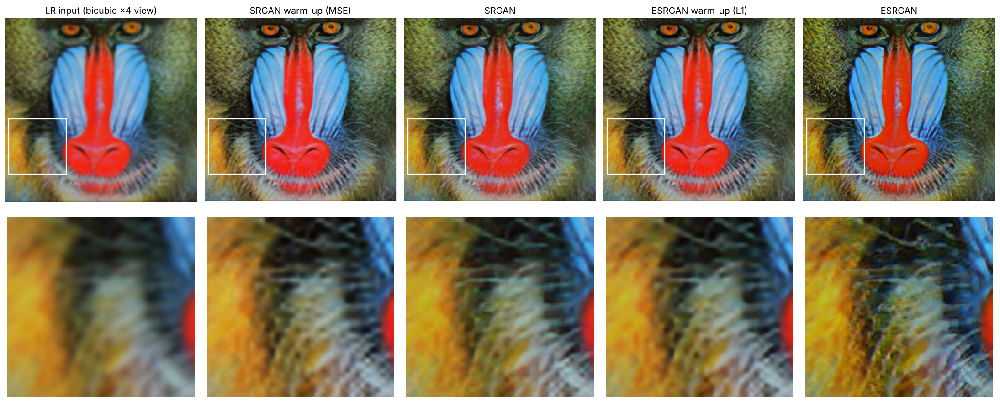
*4× upscaling of `baboon.png` (125×120 → 500×480). Bottom row zooms into the white box: ESRGAN recovers the sharpest fur texture, while the pixel-loss models stay smooth.*

---

## Key results

| Model | Training objective | PSNR (dB) ↑ |
|---|---|---|
| SRGAN warm-up ("MSE model") | MSE only | 25.45 |
| **SRGAN** | MSE + VGG + adversarial | **25.57** |
| ESRGAN | L1 + VGG (pre-activation) + RaGAN | 21.69 |
| ESRGAN, pretrained weights\* | Released weights from [source], not trained here | 17.35 |

*Average PSNR over 10 DIV2K validation images at full 2K resolution. Each image is downscaled 4× with bicubic interpolation, then upscaled back by the model.*

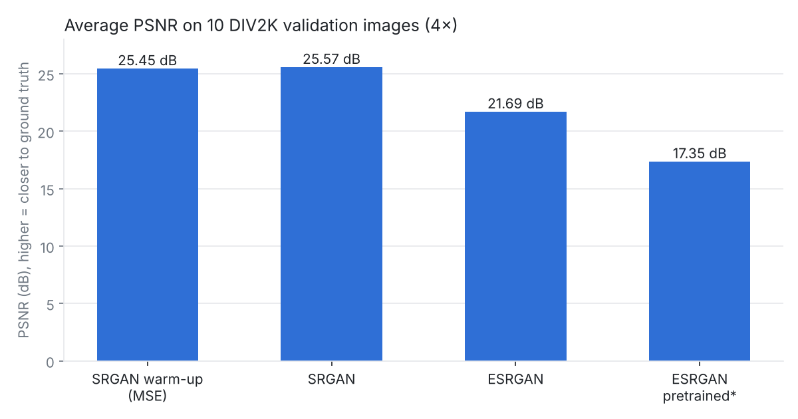

\* Included as a reference point. Its unusually low PSNR most likely comes from a preprocessing mismatch with how these weights were trained (e.g. input range or colour order), not from the model itself.

**What the numbers show**

- **Pixel-loss models win on PSNR.** PSNR rewards pixel-wise closeness, which is exactly what MSE minimises. SRGAN stays within 0.12 dB of its MSE warm-up because the adversarial term is weighted lightly (1e-5) and the GAN phase is short (20 epochs).
- **ESRGAN scores ~3.9 dB lower but looks sharper.** Its perceptual and relativistic adversarial losses push it to generate high-frequency texture (fur, edges). These details look realistic but don't match the ground truth pixel by pixel, so PSNR penalises them.
- **Takeaway:** PSNR alone is not enough to judge generative super-resolution. Perceptual metrics (e.g. LPIPS) or human evaluation are needed alongside it.

### Per-model outputs (baboon, 4×)

| SRGAN warm-up (MSE) | SRGAN |
|---|---|
| 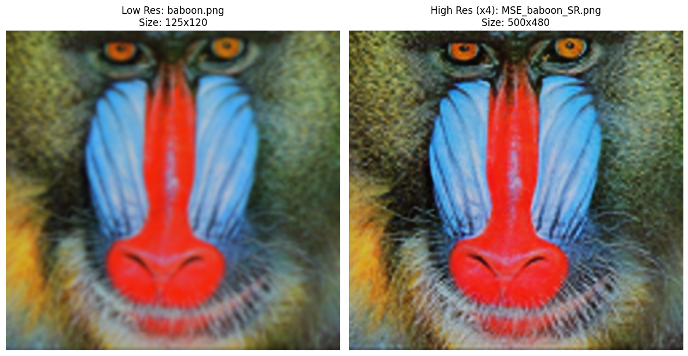 | 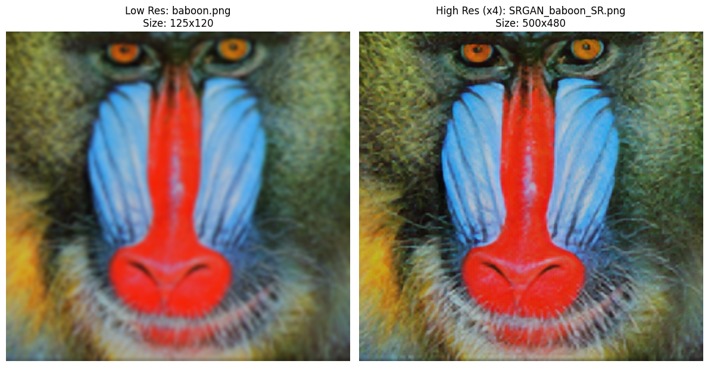 |
| **ESRGAN warm-up (L1)** | **ESRGAN** |
| 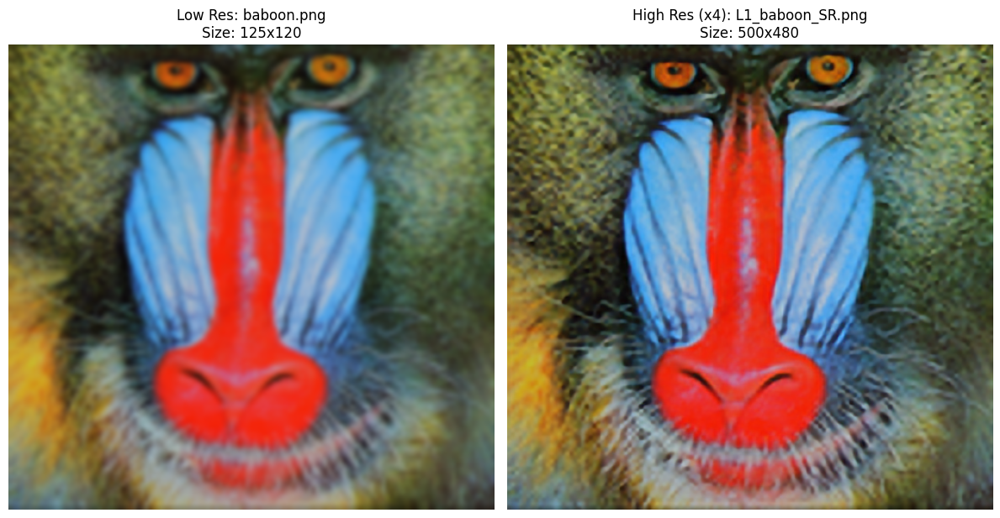 | 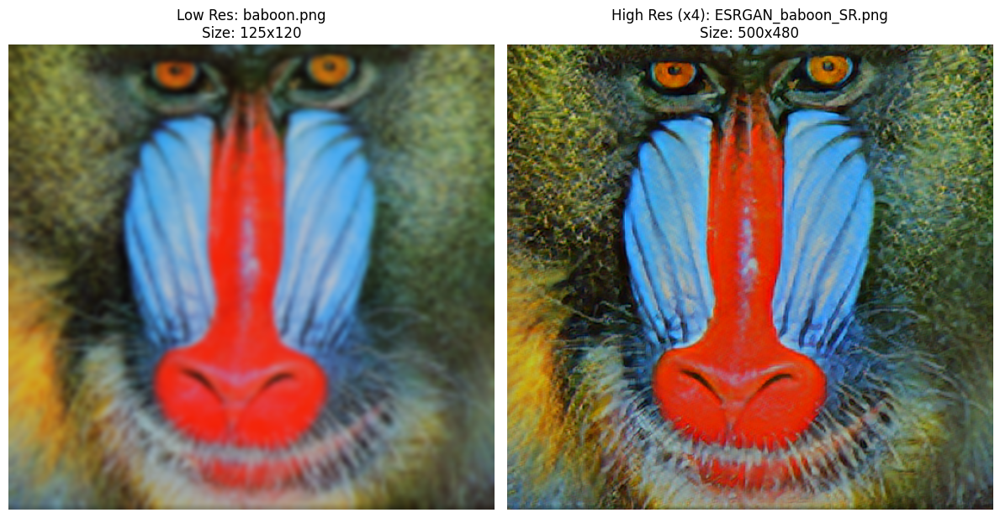 |

---

## Evaluation pipeline

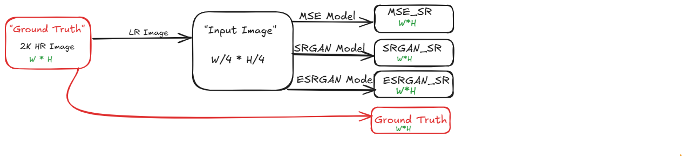

1. A 2K high-resolution image (ground truth, W×H) is downscaled 4× with bicubic interpolation → LR input (W/4 × H/4).
2. Each model upscales the LR input back to W×H.
3. The output is compared with the ground truth using PSNR, and visually.

---

## Dataset

**[DIV2K](https://data.vision.ee.ethz.ch/cvl/DIV2K/)**: high-resolution 2K images.

| Split | Images | Use |
|---|---|---|
| Train | 800 | random crops for training |
| Validation | 100 | 10 used for the PSNR evaluation |

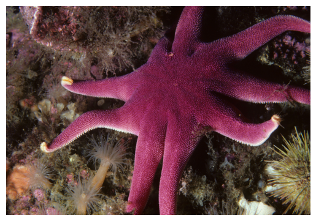
*Example training image (2040×1404).*

**Training data:** random HR crops (96×96 for SRGAN, 128×128 for ESRGAN), with horizontal flips and 90° rotations. The LR input is made on the fly by bicubic 4× downscaling of the same crop.

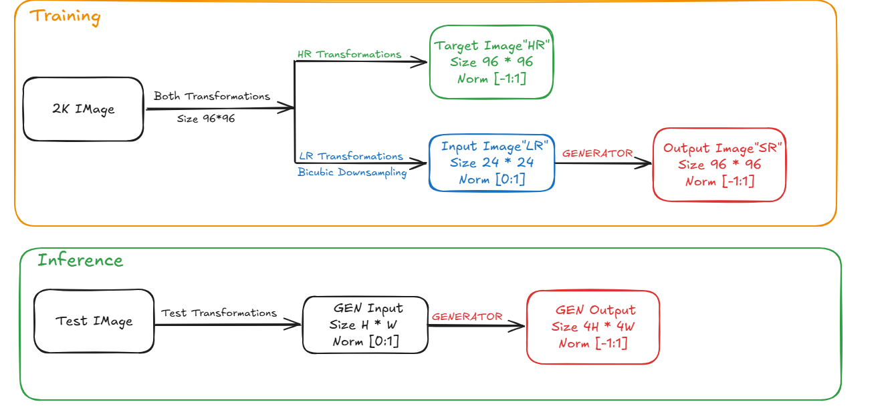
*SRGAN data pipeline: one random 96×96 crop is the HR target ([-1, 1]); its 24×24 bicubic downscale is the generator input ([0, 1]).*

| LR patch vs. HR patch | LR input vs. original (DIV2K #0898) |
|---|---|
| 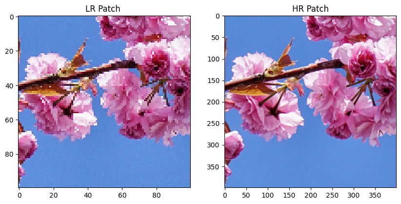 | 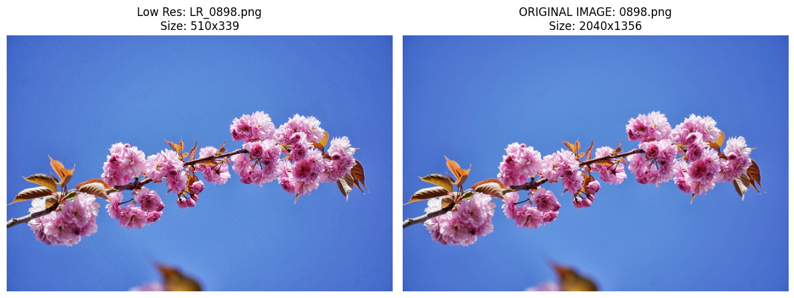 |

---

## Models

### SRGAN ([Ledig et al., 2017](https://arxiv.org/abs/1609.04802))

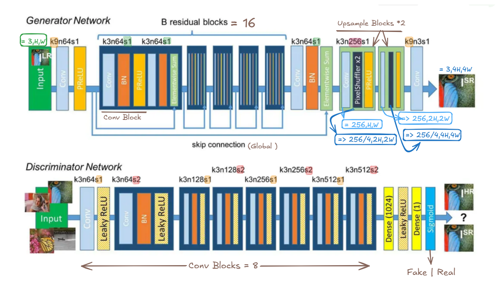

- **Generator:** 9×9 input conv, 16 residual blocks (Conv → BN → PReLU), two PixelShuffle ×2 upsampling blocks, 9×9 output conv.
- **Discriminator:** VGG-style CNN with BatchNorm and LeakyReLU, one real/fake output.
- **Training:**
  1. *Warm-up:* generator trained with MSE only for 100 epochs.
  2. *GAN phase:* 20 epochs with `0.05·MSE + 0.04·VGG(φ5,4) + 1e-5·adversarial`.

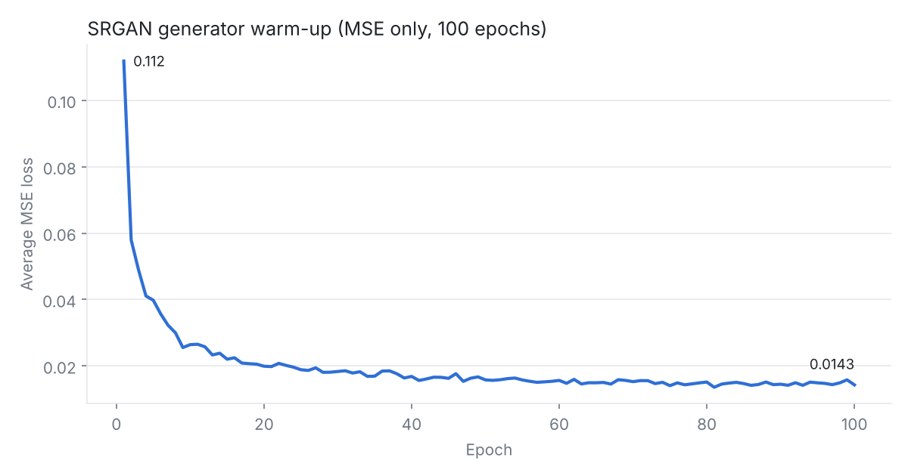
*The MSE warm-up loss drops from 0.112 to 0.026 in the first 10 epochs, then flattens around 0.015 (final: 0.0143).*

### ESRGAN ([Wang et al., 2018](https://arxiv.org/abs/1809.00219))

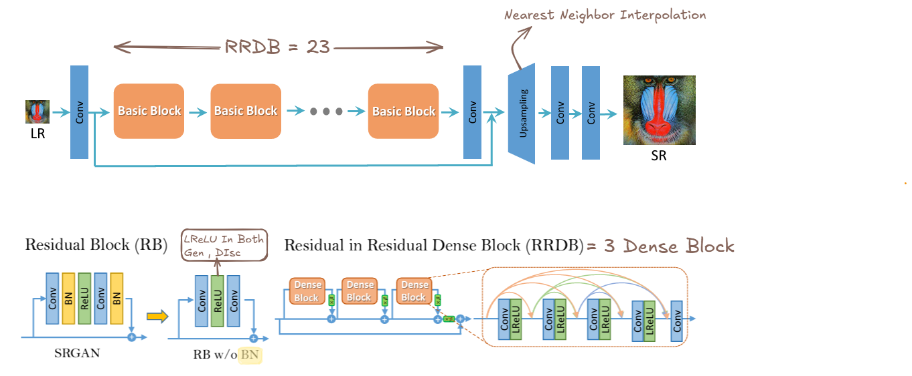

What changes from SRGAN:

- **Generator:** 23 Residual-in-Residual Dense Blocks (RRDB, 3 dense blocks each), **no BatchNorm**, residual scaling β = 0.2, nearest-neighbour upsampling + conv.
- **Pixel loss:** L1 instead of MSE.
- **Perceptual loss:** VGG features taken **before** the activation, which keeps more low-level detail.
- **Adversarial loss:** Relativistic average GAN (RaGAN): the discriminator predicts whether a real image is *more realistic than* the average fake, not just real vs. fake.
- **Training:**
  1. *Warm-up:* generator trained with L1 only for [N] epochs.
  2. *GAN phase:* [N] epochs with `1e-2·L1 + VGG + 5e-3·RaGAN`, using mixed precision (AMP).

### Training settings

| | SRGAN | ESRGAN |
|---|---|---|
| Scale | 4× | 4× |
| HR crop / LR input | 96×96 / 24×24 | 128×128 / 32×32 |
| Batch size | 16 | 16 |
| Iterations per epoch | 50 | 50 |
| Optimiser | Adam, lr 1e-4 | Adam, lr 1e-4 |
| Warm-up epochs | 100 (MSE) | [N] (L1) |
| GAN epochs | 20 | [N] |
| Hardware | Google Colab, NVIDIA T4 (~40 s/epoch) | Google Colab, NVIDIA T4 |

---

## Repository structure

```
├── Ibrahim_Ahmed_Super_Resolution.ipynb   # full pipeline: data, models, training, evaluation
├── images/                                # figures used in this README
├── LICENSE
└── README.md
```

The notebook has five parts:

1. Introduction & dataset
2. SRGAN: config, utils, dataset, model, perceptual loss, warm-up, GAN training
3. ESRGAN: config, utils, dataset, model, loss, warm-up, GAN training
4. Results: inference on validation images, visual comparison, PSNR
5. Conclusion

---

## How to run

1. Open the notebook in Colab (badge above) and select a GPU runtime.
2. Download DIV2K (train + valid HR) and put the archive on Google Drive.
3. Update the dataset and checkpoint paths in the notebook to your Drive folders.
4. Run the cells in order. Checkpoints are saved after every epoch, so training can resume after a disconnect.

**Requirements:** `torch`, `torchvision`, `albumentations`, `opencv-python`, `scikit-image`, `Pillow`, `matplotlib`, `tqdm`.

---

## Limitations and next steps

- PSNR is computed on only 10 images; a standard benchmark (Set5, Set14, BSD100) would be more reliable.
- No perceptual metric yet: adding **SSIM** and **LPIPS** would quantify ESRGAN's visual advantage.
- The SRGAN GAN phase is short (20 epochs) with a small adversarial weight, so it stays close to the MSE baseline.
- The pretrained ESRGAN weights should be re-checked with their expected input normalisation for a fair comparison.

---

## Authors

[Names / team members]

## Acknowledgements

- Ledig et al., *Photo-Realistic Single Image Super-Resolution Using a Generative Adversarial Network*, CVPR 2017. [arXiv:1609.04802](https://arxiv.org/abs/1609.04802)
- Wang et al., *ESRGAN: Enhanced Super-Resolution Generative Adversarial Networks*, ECCV Workshops 2018. [arXiv:1809.00219](https://arxiv.org/abs/1809.00219)
- Implementation adapted from Aladdin Persson's [SRGAN](https://github.com/aladdinpersson/Machine-Learning-Collection/tree/master/ML/Pytorch/GANs/SRGAN) and [ESRGAN](https://github.com/aladdinpersson/Machine-Learning-Collection/tree/master/ML/Pytorch/GANs/ESRGAN) PyTorch code.
